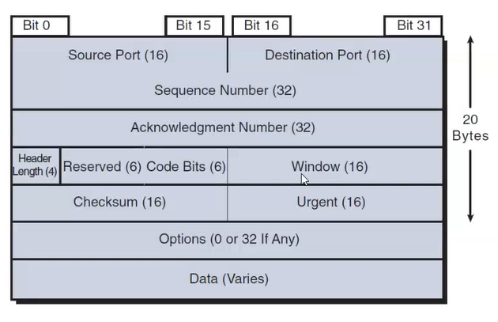

Clase 3

# Modelo TPC/IP ([[Clase_2]])

TCP/IP - Son las reglas por la que ahora operan las redes. las primeras tres capas sin las capa de aplicacion (aplicacion, Presentacion, Sesion)

Transporte se queda como Transporte

la Capa de Red se queda como Internet

la Capa de Datos y Fisica se llama Acceso de la Red

Modelo TCP/IP
|Application| 
|Transport| 
Internet|
|Access|

## Capa de Applicacion

Direccion IP -> Direccionamiento Logico

Domain Name System (DNS): Proporciona una direccion IO de un sitio web o nombre de dominio para que un host se puede conectar, el IP es direccionamiento logico. el DNS es una traduccion a los IP

HTTP: Transfiere Informacion entre clientes web y servidores web.

Simple Mail Transfer Protocol: Facilitia envio de mensajes de text

Dynamic Host Configuration Protocol:asigna direcciones alos IP de los clientes solicitantes

File Tranfer Protocol: Facilita carga y descarga de archivos entre servidor y cliente

Simple Network Managment Protocol: Sistema de administracion de red de monitorio de dispositivos

## Capa de Transporte

TCP- Transport Control Protocol
Garantiza mecanismo para garantizar la entrega de datos a atraves de la red. TCP admite la recuperacion de errores en la capa de aplicacion mediante el uso de logica de reconocimiento basica.

TCP debe recuperar datos si se pierden datos en algun momento durante el proceso. Solicitud de retransmicion

User Datagram Protocol - protocolo que no requiere nu necesesita recuperacion de error, es un protocolo no confiable y sin conextion

### Caracteristicas de Protocolo de Transaporte
- Multiplexacion usando puertos: Numeracion de Puertos Distintos, cada sevicio tiene su puerto
- Control de flujo usando ventanas: Tamano de ventana deslizante que dos dispositivos acuerdan, recursos dividos entre todos los usuarios.
- Recuperacion de error: Proceso de enumeracion y reconocimiento de datos con Secuencia y Campos de encabezado de reconocimiento
- Estrablecimiento y terminacion de la conexion: Proceso de inicio

### Formato del encabezado 

Cuantos Combinaciones se puede hacer 2^(16), numero de secuencia 2^(32). 

HTTP: Puerto 80
HTTPS: 443

los encabezados corruptos se checan a traves del checksum.

puerto comunes
![[Pasted image 20261114113242.png]]

## Establecmineto de Conexcion

Proceso a traves de :
Secquence, Acknoloedgment, SrcPort, DstPort, Window
la fase de conexcion de tres vias debe ocurri antes de que pueda proceder la tranferencia de datos

![[Pasted image 20261114113943.png]]

Finalizacion de Sesion
![[Pasted image 20261114114230.png]]

al final de la sesion se genera una secuencia de terminacion de 4 vias.

#### UDP

UDP no hace handshakes, es un protocolo sin conexion, pierdo cierta confiabilidad de entrega, pero ganamos velocidad de entrega de datos.

### Capa de Internet TCP/IP

La capa de internet de modelo TPC/IP y sus protocolos de internet IP definen direcciones para que cada host pueda tener una direccion IP diferente.

## Comandos de Red

![[Pasted image 20261114121000.png]]

ipconfig /? -> ayuda del parametro ipconfig
ipconfig /all -> regresa todos los datos incluyendo el MAC

![[Pasted image 20261114121537.png]]

comando a capa nivel 3, verifica si la conexion existe
puertos estan en capa de transporte

el ping usa el ISMP y utiliza un protocolo tipo echo, que sirve para escuchar una respuesta. no es un handshake.

el comando ping no me dice si cuando la conexion se reompe para hacer uso usamos el traceroute

![[Pasted image 20261114122800.png]]

el protocolo de resolucion de direcciones ARP

Checa todas las direcciones IP a las que esta conectado el equipo

el comando nslookup, checa la conexion con servers o host locales o desconocidos

![[Pasted image 20261114123811.png]]

route es para minpulacion de tablas de enrutamiento

